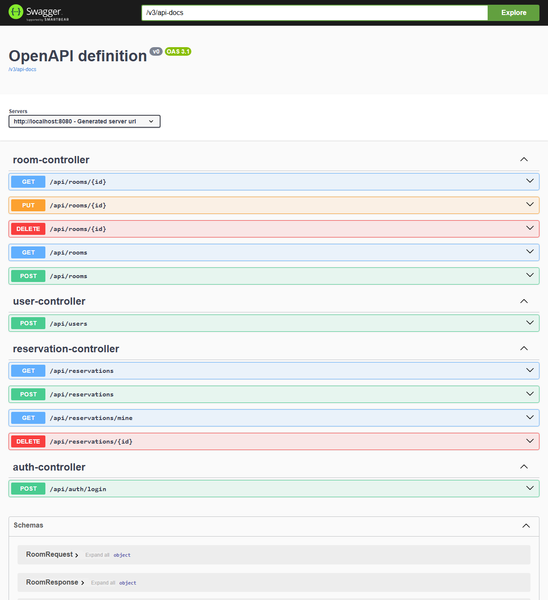
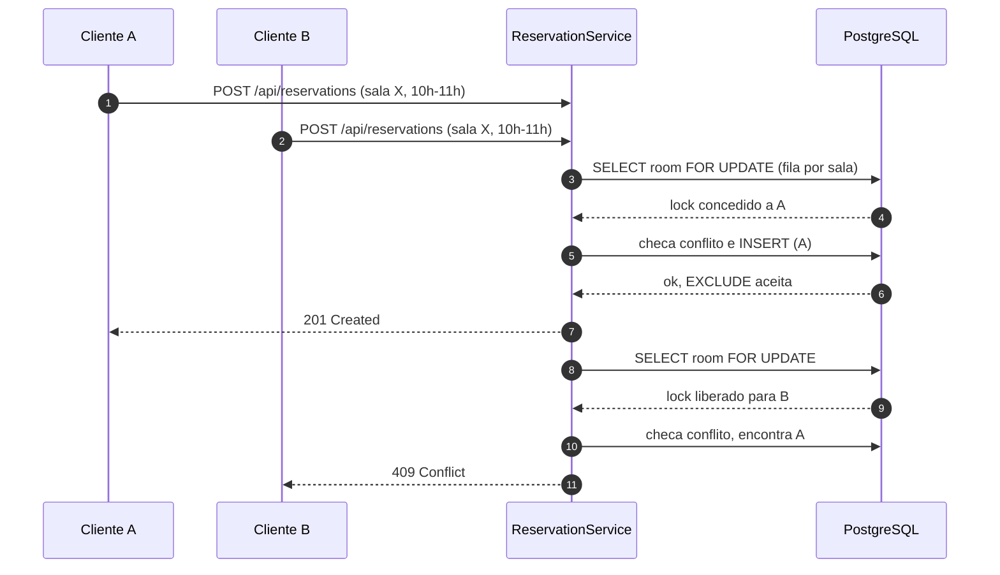

# Duas pessoas nunca deveriam reservar a mesma sala no mesmo horário: esta API garante isso no banco.

[](https://github.com/Famel-svg/reserva-salas/actions/workflows/ci.yml)
-brightgreen)


API REST de reserva de salas compartilhadas, sem sobreposição de horário, com autenticação JWT e papéis `MEMBER` e `ADMIN`.



## Por que este projeto existe

É um projeto de portfólio para vagas júnior de Java. O objetivo é mostrar, num código pequeno e testado, decisões que costumam dar errado em sistemas reais:

- **Concorrência de intervalo de tempo.** Duas reservas da mesma sala no mesmo horário são um problema de corrida. A regra fica garantida pelo banco com `EXCLUDE USING gist` sobre `tstzrange`, e não em um `if` no código.
- **Autorização por dono do recurso.** Um usuário não cancela reserva alheia. Isso evita IDOR (retornar 403 e não 404 quando o recurso existe, mas não é seu).
- **Erros padronizados.** Todas as falhas saem em ProblemDetail (RFC 9457), sem stack trace.
- **Testes que provam a regra.** Inclui um teste de concorrência com 20 threads, em que exatamente uma reserva passa.

## Funcionalidades

- CRUD de salas, restrito a `ADMIN`.
- Reserva com início e fim em UTC (`timestamptz`), granularidade de 15 minutos, duração máxima de 4 h e sem início no passado.
- Horários encostados (10h–11h e 11h–12h) são aceitos. O intervalo é semiaberto `[)`.
- Cancelamento: o dono cancela até 2 h antes do início; `ADMIN` cancela a qualquer hora; outro usuário recebe 403.
- Limite de 3 reservas ativas por usuário (422 ao passar).
- Login com senha BCrypt e JWT de acesso curto (15 min).
- Só `ADMIN` cadastra usuários. Não há cadastro público.

## Como a não sobreposição é garantida



A EXCLUDE é a garantia final e vale mesmo se alguém acessar o banco sem passar pela API. O lock por sala evita que duas transações concorrentes entrem em deadlock na EXCLUDE (veja o [ADR 0001](docs/adr/0001-exclude-gist-em-vez-de-lock.md)).

## Quick start

Pré-requisitos: Docker com Compose. Não é preciso Java nem Maven.

```bash
cp .env.example .env
```

Gere um segredo JWT e cole no `.env` no lugar de `JWT_SECRET`:

```bash
openssl rand -base64 48
```

Suba app e banco:

```bash
docker compose up --build
```

Em outro terminal, confira o health e faça login com o admin de dev (definido no `.env`):

```bash
curl -s http://localhost:8080/health
```

```bash
curl -s -X POST http://localhost:8080/api/auth/login \
  -H 'Content-Type: application/json' \
  -d '{"email":"admin@reserva.local","password":"troque-esta-senha-de-dev"}'
```

Use o `accessToken` retornado no cabeçalho `Authorization: Bearer <token>`. Você também pode testar tudo pelo Swagger em <http://localhost:8080/swagger-ui.html>.

Este quick start foi executado do zero (stack parado, `docker compose down -v`, depois `up --build`) e respondeu `/health` com 200.

## Veja o 409 na prática

Duas reservas no mesmo horário, na mesma sala. A segunda recebe 409:

```bash
# primeira reserva: 201
curl -s -X POST http://localhost:8080/api/reservations \
  -H "Authorization: Bearer $TOKEN" -H 'Content-Type: application/json' \
  -d '{"roomId":"<id-da-sala>","startsAt":"2026-10-24T10:00:00Z","endsAt":"2026-10-24T11:00:00Z"}'

# sobreposição parcial: 409
curl -s -w '\nHTTP %{http_code}\n' -X POST http://localhost:8080/api/reservations \
  -H "Authorization: Bearer $TOKEN" -H 'Content-Type: application/json' \
  -d '{"roomId":"<id-da-sala>","startsAt":"2026-10-24T10:30:00Z","endsAt":"2026-10-24T11:30:00Z"}'
```

Resposta real da segunda chamada:

```json
{"type":"about:blank","title":"Conflito","status":409,"detail":"Sala já reservada neste horário","instance":"/api/reservations"}
HTTP 409
```

## Teste de concorrência

Vinte threads disparam reservas no mesmo horário e na mesma sala, com largada simultânea. Saída real do teste:

```
CONCURRENCY RESULT: 201=1 409=19 other=[]
```

Para rodar a suíte completa (precisa de Docker para o Testcontainers):

```bash
JWT_SECRET=ci-only-secret-com-mais-de-32-bytes-0123456789 ./mvnw verify
```

A suíte tem 59 testes: unitários de regra de negócio, `@WebMvcTest` de segurança e testes ponta a ponta com PostgreSQL 16 real. O gate JaCoCo exige 80% de linhas e o projeto está em cerca de 87%.

## Endpoints por papel

| Método | Rota | Público | MEMBER | ADMIN |
|---|---|:-:|:-:|:-:|
| POST | `/api/auth/login` | sim | | |
| GET | `/health` | sim | | |
| GET | `/api/rooms` | | sim | sim |
| GET | `/api/rooms/{id}` | | sim | sim |
| POST | `/api/rooms` | | | sim |
| PUT | `/api/rooms/{id}` | | | sim |
| DELETE | `/api/rooms/{id}` | | | sim |
| POST | `/api/users` | | | sim |
| POST | `/api/reservations` | | sim | sim |
| GET | `/api/reservations/mine` | | sim | sim |
| GET | `/api/reservations` | | | sim |
| DELETE | `/api/reservations/{id}` | | dono, até 2 h antes | sim, qualquer hora |

Documentação interativa: <http://localhost:8080/swagger-ui.html>.

## Decisões de arquitetura

As decisões estão em [`docs/adr`](docs/adr):

1. [EXCLUDE gist em vez de `@Version` ou lock pessimista](docs/adr/0001-exclude-gist-em-vez-de-lock.md)
2. [JWT stateless sem refresh](docs/adr/0002-jwt-stateless-sem-refresh.md)
3. [Pacote por funcionalidade](docs/adr/0003-pacote-por-funcionalidade.md)
4. [ProblemDetail para erros](docs/adr/0004-problemdetail-para-erros.md)

O histórico de cada commit está em [`docs/CHANGELOG.md`](docs/CHANGELOG.md).

## Configuração

Tudo vem de variáveis de ambiente. Veja [`.env.example`](.env.example).

| Variável | Obrigatória | Descrição |
|---|:-:|---|
| `JWT_SECRET` | sim | Segredo HS256 de no mínimo 32 bytes. Não tem valor padrão: o app não sobe sem ele. |
| `JWT_TTL` | não | Duração do token, ISO 8601. Padrão `PT15M`. |
| `DB_URL`, `DB_USER`, `DB_PASSWORD` | não | Conexão com o PostgreSQL. |
| `SPRING_PROFILES_ACTIVE=dev` + `ADMIN_EMAIL` + `ADMIN_PASSWORD` | não | Cria o admin inicial só no perfil `dev`. Nunca em migration. |

O actuator expõe somente `/health`.

## O que eu faria diferente

- **Lock por sala como gargalo.** Hoje a criação de reservas da mesma sala é serializada. Para uma sala muito disputada, eu mediria antes de decidir entre manter isso ou partir para uma fila ou um controle de capacidade por slot.
- **Cancelar não é idempotente.** Cancelar uma reserva já cancelada devolve 200 de novo. Eu deixaria explícito (409 ou 204 com regra clara).
- **Apagar sala com reservas dá 409.** A chave estrangeira protege, mas o usuário merece uma mensagem clara. Eu marcaria a sala como inativa em vez de apagar.
- **Login revela tempo de resposta.** A mensagem de erro é igual para e-mail inexistente e senha errada, mas o BCrypt só roda quando o usuário existe. Eu igualaria o tempo com um hash fictício.
- **Sem revogação de token.** Com o TTL de 15 min o risco é pequeno, mas um logout real pediria lista de revogação ou refresh token.
- **Extensão `btree_gist` na migration.** Exige privilégio de superuser ou extensão confiável no ambiente. Em produção eu separaria essa etapa do Flyway.

## Fora do MVP (evolução)

Ficaram de fora de propósito, para manter o escopo fechado:

- Refresh token e revogação de sessão.
- Rate limit no login e nas rotas de escrita.
- Reserva recorrente.
- Notificação por e-mail.
- Cache com Redis.
- Front-end.
- Mensageria para eventos de reserva.

